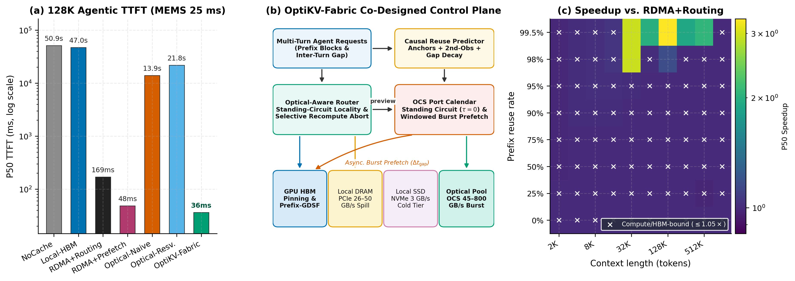

# OptiKV-Fabric

**Interconnect-Aware Lossless KV Cache Scheduling over Reconfigurable Optical Circuit Switches for Agentic LLM Serving**

[](LICENSE)
[](requirements.txt)
[](tests/)

[English](#overview) | [简体中文](#简体中文简介)

---

## Overview

**OptiKV-Fabric** is a trace-driven, GPU-calibrated simulation and scheduling framework studying lossless Key-Value (KV) cache management over Reconfigurable Optical Circuit Switches (OCS) for multi-turn, long-context Large Language Model (LLM) agents.

Multi-turn agentic workloads exhibit high causal prefix reuse (55.3%–98.4% across Mooncake, LMCache, and FreeInference) and growing prompt lengths (24K–170K+ tokens), causing active KV caches to overflow single-GPU HBM. While optical circuit switches provide high exclusive bandwidth (45–800 GB/s) at ~100× lower switch port power than electrical 400G packet switches, mechanical MEMS switching latencies (25–50 ms) and port exclusivity degrade interconnect-blind schedulers (*Optical-Naive*). Guided by three closed-form roofline crossover laws, OptiKV-Fabric centers on a single state primitive—the **OCS Port Calendar**—to resolve three coupled scheduling questions in closed loop:

1. **Optical Transfer vs. Exact Recomputation**: Standing-circuit pool-first coalescing exploits latched ports ($\tau_{\text{eff}} = 0$) and coalesces unlatched bursts through the shared Optical KV Pool, while lossless selective recompute abort cancels fetches whenever optical wait plus reconfiguration exceeds local delta prefill.
2. **Hiding 25–50 ms MEMS Switching**: Congestion-gated windowed burst prefetching schedules asynchronous optical transfers inside natural inter-turn agent tool pauses (0.71–2.22 s median), sustaining 80%–95% mechanical MEMS duty cycles.
3. **Prefix-Dependency-Aware Retention**: Strictly causal online reuse prediction (Agent Anchors, second-observation promotion, gap decay) drives **Prefix-GDSF** eviction and five-tier lossless spill placement under request-unit block pinning.



---

## Key Verified Results

All numbers below are reproducible directly from the included RTX 3090 calibration logs (`results/3090/`) and simulation summaries (`results/sim/`):

- **Real-GPU Calibration (NVIDIA RTX 3090 24 GB, `Qwen2.5-7B-Instruct`, BF16, vLLM 0.34.0 & Bare-Metal PyTorch 2.14.1+cu126)**:
  - **3.08% analytical roofline MAPE** across 1K–32K cold prefills (6.25% held-out extrapolation MAPE on 24K/32K).
  - **21.1×–94.5×** measured multi-length Automatic Prefix Caching speedups across 4K–30K cached prefixes (`24.16×` on controlled 4K+128 ON/OFF, `94.47×` at 24K+128, `40.88×` at 30K+512).
  - **Live 40.7× single-GPU HBM capacity cliff** ($N=1\dots20 \times 8\text{K}$ concurrent sessions): Turn-2 hit rate collapses from **100.0% → 0.0%** and TTFT jumps **43.9 ms → 1,788.1 ms** past vLLM's 4.70 GiB (88K-token) KV ceiling.
  - **25.91 / 25.93 GB/s** bare-metal 28-layer PCIe Gen4 H2D/D2H KV offloading and **$\alpha_{\text{ovl}} = 0.926$** median dual-CUDA-stream overlap (range `0.860–0.980`), plus **24.68 / 25.24 ms/tok** OLS-derived decode TPOT ($R^2 > 0.999$) and **3.15×–5.08×** cluster speedup across the entire $\alpha_{\text{ovl}} \in [0, 1]$ sweep.
- **End-to-End Multi-Trace Evaluation (8 Workers, H100 Peak-Spec Scaling, 25 ms MEMS OCS vs. 25 GB/s RDMA, including upgraded 2025–2026 electrical SOTA `RDMA+Prefetch`)**:

| Workload / Benchmark | RDMA+Routing | RDMA+Prefetch (SOTA) | **OptiKV-Fabric** | Key Improvement |
| :--- | :---: | :---: | :---: | :--- |
| **LMCache Agentic** (120 sess, MEMS 25 ms) | 25.3 ms P50 | 17.8 ms P50 | **18.5 ms P50 (95.4% duty)** | **-26.9% vs. RDMA+Routing**, **101.0× Goodput/W** |
| **FreeInference Long** (25 sess, MEMS 25 ms) | 91.3 ms P50 | 47.2 ms P50 | **44.9 ms P50 (90.9% duty)** | **-50.8% vs. RDMA+Routing (-4.9% vs. RDMA+Prefetch)**, **100.9× Goodput/W** |
| **128K Interactive Load** (250 ms SLO, 1–32 req/s) | 1.55 req/s peak (0 @ 32) | 5.46 req/s peak (2.72 @ 32) | **6.58 req/s (Oracle floor)** | **4.25× vs. RDMA+Routing**, **2.42× @ 32 req/s vs. RDMA+Prefetch**, **122× Goodput/W** |
| **5-Fold Disjoint CV (LMCache, 767 sess)** | 24.55 ± 1.21 ms | 17.06 ± 0.27 ms | **18.37 ± 0.36 ms (93.0% duty)** | **25.08% ± 2.22%** paired reduction vs. RDMA+Routing, >100× Goodput/W |
| **5-Fold Disjoint CV (FreeInference, 40 sess)** | 74.83 ± 28.57 ms | 62.24 ± 27.96 ms | **57.37 ± 26.73 ms (80.4% duty)** | **25.04% ± 9.92%** vs. RDMA+Routing (**+7.03%** vs. RDMA+Prefetch) |
| **Single-GPU HBM Eviction** (2 GiB, LMCache) | 26.33% (LRU) | 30.24% (S3-FIFO) | **32.98% (Prefix-GDSF)** | **+6.65 pp over LRU / +2.74 pp over S3-FIFO** (95.0% of Belady 34.72%) |

---

## Quick Start

### 1. Environment Setup

```bash
git clone https://github.com/WYH302/OptiKV-Fabric.git
cd OptiKV-Fabric
pip install -r requirements.txt
pip install -e .
```

### 2. Run Automated Physical Conservation & Calibration Tests

```bash
pytest tests/ -v
```

Expected output: **16 passed** in <1 second (verifies GQA/MLA/Hybrid KV formulas, RTX 3090 calibration MAPE <10%, zero pinned evictions, strict Oracle & Belady dominance across all 12 policies, standing-circuit $\tau = 0$, and recompute abort safety).

### 3. Regenerate All 8 Publication Figures from Included Results

```bash
python scripts/make_publication_figures.py
```

Figures are written to `figures/fig1_teaser.{pdf,png}` through `figures/fig8_p99_load.{pdf,png}`.

### 4. Re-Run Full Trace Simulations & 5-Fold Cross-Validation

To re-execute trace-driven experiments from scratch, place the public trace datasets under `datasets/`:
- **Mooncake Traces**: [kvcache-ai/Mooncake](https://github.com/kvcache-ai/Mooncake) (`datasets/mooncake-traces/`)
- **LMCache Agentic Traces**: [LMCache](https://github.com/LMCache/LMCache) (`datasets/lmcache-agentic-traces/`, tokenized via `python scripts/cache_lmcache_tokens.py`)
- **FreeInference Traces**: [Zenodo 10.5281/zenodo.23903440](https://doi.org/10.5281/zenodo.23903440) (`datasets/freeinference-agentic-trace/`)

Then run:

```bash
python scripts/run_full_suite.py
python scripts/run_suites_3_to_6_refined.py
python scripts/run_stage2_audit_and_cv.py
python scripts/run_overlap_sensitivity.py
python scripts/make_publication_figures.py
```

---

## Repository Structure

```text
OptiKV-Fabric/
├── src/
│   ├── optikv/               # Core simulator: OCS Port Calendar, causal predictor, prefill roofline, metrics
│   └── policies/             # 12 scheduling & eviction policies (incl. RDMA+Prefetch, S3-FIFO, Belady, OptiKV)
├── configs/                  # Model KV profiles (Qwen2.5/3/3.5, Llama-3.1, DeepSeek-V3) & RTX 3090 calibration YAML
├── scripts/                  # Calibration, trace profiling, full simulation suite, 5-fold CV & figure scripts
├── tests/                    # 16 automated invariant & calibration accuracy checks
├── results/
│   ├── 3090/                 # Measured RTX 3090 7B prefill, decode, APC, and PCIe Gen4 DMA CSVs
│   ├── sim/                  # Experiment, sensitivity, ablation, load-sweep, ROI, and 5-fold CV CSVs
│   ├── tables/               # Consolidated paper metrics JSON & LaTeX tables
│   └── trace_stats/          # Profiled trace summary statistics
├── figures/                  # Rendered publication figures (PNG)
├── pyproject.toml
├── requirements.txt
└── LICENSE
```

---

## Engineering Insights & Pitfalls Overcome

During hardware calibration and simulator verification, we encountered three non-obvious systems pitfalls that directly shaped OptiKV-Fabric's final design and evaluation:

1. **Windows WDDM Dual-CUDA-Stream Batching Artifact (`0.04 → 0.93` Overlap)**: In initial 28-layer KV offload microbenchmarks on bare-metal Windows CUDA, enqueueing all 28 H2D copies before kernel dispatch caused the WDDM driver to batch transfers serially before layer 0 compute began, collapsing apparent overlap to `0.04–0.07`. Switching to interleaved per-layer producer–consumer CUDA events with explicit `stream.query()` flushes and full 28-layer GPU KV buffers exposed true hardware PCIe Gen4 pipelining (**25.91/25.93 GB/s**, median $\alpha_{\text{ovl}} = 0.926$, range `0.860–0.980`).
2. **Quadratic Marginal-Cost Inversion in Naive GDSF**: Scoring KV blocks independently by their per-block incremental prefill cost causes naive GDSF to over-protect late suffix blocks (whose quadratic attention cost is larger) and prematurely evict early prefix root blocks—invalidating the entire downstream suffix chain upon lookup. Replacing marginal cost with protected downstream recomputation cost $\Delta T_{\text{protected}}(b_i)$ in **Prefix-GDSF** ensures leaves always evict before roots, lifting single-GPU HBM hit rate to **32.98%** (+6.65 pp over LRU, +2.74 pp over S3-FIFO, **95.0%** of offline Belady).
3. **Live 4.70 GiB HBM Cyclical LRU Thrashing Cliff (`40.7×` TTFT Jump)**: Measuring round-robin multi-session 8K prompts on a real 24 GB RTX 3090 running vLLM 0.34.0 revealed that once concurrent working sets exceed the 4.70 GiB (88K-token) paged KV pool from $N=10$ to $N=12$ sessions, hit rate does not degrade gracefully—it drops sharply from **100.0% to 0.0%**, driving a **40.7×** median TTFT spike (`43.9 ms → 1,788.1 ms`). This empirical discontinuity underscores why pooled multi-tier spilling and prefix-root protection are mandatory for multi-turn agents.

---

## Citation

If you find this codebase or dataset analysis helpful for your research, please consider citing:

```bibtex
@article{wu2026optikv,
  author  = {Yonghao Wu},
  title   = {{OptiKV-Fabric}: Interconnect-Aware Lossless {KV} Cache Scheduling over Reconfigurable Optical Circuit Switches for Agentic {LLM} Serving},
  journal = {Manuscript under review},
  year    = {2026}
}
```

Contact: Yonghao Wu (`yonghaowu369@gmail.com`), School of Electronic Science and Engineering (School of Microelectronics), South China Normal University.

---

## 简体中文简介

**OptiKV-Fabric** 是一个面向多轮、长上下文 Agentic LLM 推理场景的光互连感知无损 KV Cache 调度与硬件校准仿真框架。项目基于真实 NVIDIA RTX 3090 24 GB（`Qwen2.5-7B-Instruct` BF16，324 次 vLLM 0.34.0 前向与 224 次裸机 28 层 CUDA 卸载/重叠实测）微基准数据（1K–32K 冷 prefill 解析 Roofline 误差 **3.08% MAPE**、4K–30K 多长度热命中最高 **94.5×** 加速、24 GB HBM 显存墙 **40.7×** LRU 驱逐悬崖、28 层 PCIe Gen4 **25.9 GB/s** 与双流重叠 $\alpha_{\text{ovl}}{=}0.93$），并在 Mooncake、LMCache（24,880 请求）与 FreeInference（190,544 请求）公开真实轨迹上与包括 2025–2026 电互连预取 SOTA（`RDMA+Prefetch`）在内的 12 种策略同台对比。

### 核心设计
围绕单一状态原语 **OCS Port Calendar（光交换端口日历）**，基于三条解析 Roofline 交叉定律协同求解三个耦合问题：
- **何时用光 vs. 精确重算**：驻留光路与共享光池优先聚合（$\tau_{\text{eff}} = 0$）配合无损选择性重算中止；
- **如何隐藏 25–50 ms 机械 MEMS 切换延迟**：利用多轮 Agent 自然工具停顿间隙（中位数 0.71–2.22 s）执行拥塞门控窗口突发预取，在 25 ms MEMS 下将光交换占空比提升至 **80.4%–95.4%**；
- **前缀链式失效下的无损保留**：严格因果在线复用预测驱动 **Prefix-GDSF** 驱逐与五层无损溢出（单卡 2 GiB HBM 命中率 **32.98%**，超越 SOSP'23 `S3-FIFO` +2.74 pp，逼近理论离线最优 Belady 34.72% 的 **95.0%**）。

### 工程实践洞察与踩坑记录
- **Windows WDDM 双流批处理陷阱（$\alpha_{\text{ovl}}: 0.04 \to 0.93$）**：早期 28 层 KV 卸载实测若未采用逐层交替 Producer–Consumer CUDA Event 同步并配合 `stream.query()` 刷新 WDDM 命令队列，驱动会将全部拷贝串行前置，导致重叠率误测为 `0.04–0.07`；修正后在裸机 RTX 3090 上测得真实 PCIe Gen4 带宽 **25.91/25.93 GB/s** 与双流重叠中位数 **0.926**。
- **朴素 GDSF 的二次边际代价倒挂**：自回归注意力中后缀块的单块二次重算代价高于前缀根块，朴素 GDSF 会错误保护后缀而先驱逐前缀根块，导致整条后缀链失效；改用受保护下游前缀重算代价 $\Delta T_{\text{protected}}(b_i)$ 后，**Prefix-GDSF** 单卡命中率升至 **32.98%**（逼近 Belady 理论上限 95.0%）。
- **24 GB HBM 实卡循环 LRU 悬崖（TTFT 突增 40.7×）**：在 vLLM 0.34.0 上复现多会话 8K 轮询时，工作集一旦越过 4.70 GiB（88K tokens）上限（$N=10 \to 12$ 会话），第 2 轮命中率瞬间从 **100.0% 跌至 0.0%**，TTFT 从 **43.9 ms 暴涨至 1,788.1 ms**，从物理上印证了多级光池溢出与前缀根保护的必要性。

### 快速复现
```bash
pip install -r requirements.txt
pip install -e .
pytest tests/ -v                                # 16/16 物理守恒与校准不变量测试
python scripts/make_publication_figures.py      # 一键重新生成全部 8 张论文图表
```

欢迎通过 Issue 或邮件（`yonghaowu369@gmail.com`）交流指正。
